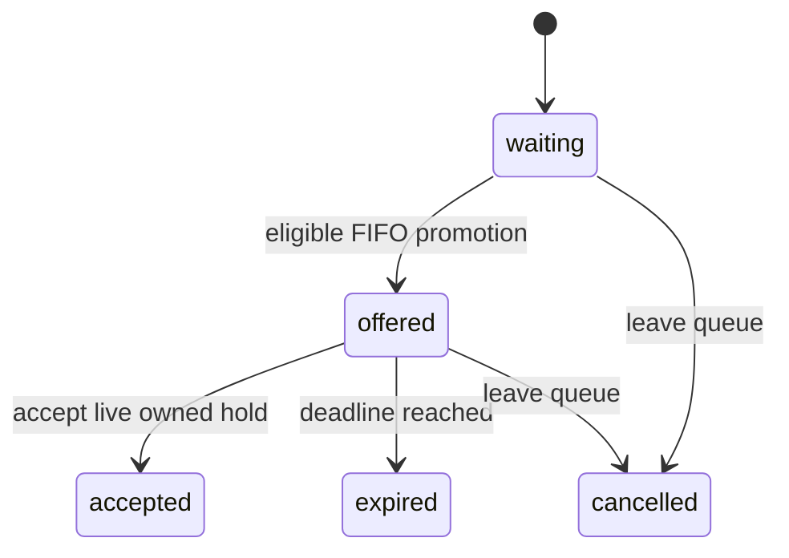

# Schema and reservation lifecycle

The schema is [database/schema.sql](../../database/schema.sql); initialization is in [backend/db.js](../../backend/db.js). It has eight application tables, all `STRICT`, and schema version 1 in `PRAGMA user_version`. SQLite's internal `sqlite_sequence` is not an application table. A newer schema version is rejected rather than downgraded.

All catalog IDs and service inputs are positive integers. Slot dates are airport-local `YYYY-MM-DD`, and times are local `HH:MM` within one day. This fixture uses Hong Kong time, UTC+08:00, without a daylight-saving adjustment. Creation/update/expiry/event timestamps come from an injected `Date` clock and are serialized with `toISOString()`, including milliseconds and a final `Z`. Never interpret a local slot start as UTC.

## Eight tables

| Table | Purpose and main constraints |
| --- | --- |
| `users` | Positive `id`, nonblank display name, demo `membership_tier` enum, UTC `created_at`. Tiers: `first`, `business`, `diamond`, `gold`, `standard`. |
| `lounges` | Positive `id`, unique nonblank `name`, `terminal_area`, same-day opening/closing times with opening before closing, boolean `active`. |
| `services` | Positive `id`, unique `code` in `shower`, `dining`, `massage`, `rest`, `work`; duration 1–240 minutes; category `wellness`, `dining`, `rest`, or `work`. `gate` is excluded. |
| `lounge_services` | Foreign keys to lounge/service, unique `(lounge_id, service_id)`, `reservation_mode` enum, nonempty JSON array `eligible_tiers`, preparation 0–60 minutes, boolean `active`. Triggers restrict JSON elements to known demo tier strings. |
| `service_slots` | Foreign key to lounge service, valid date/time, start before end, capacity 1–1000, boolean `active`, unique `(lounge_service_id, service_date, start_time)`. Walk-in rules cannot have slots. |
| `reservations` | Auto-increment `id`, user/slot foreign keys, status enum, creation/update/cancellation times, required `idempotency_key`, `operation` (`create`, `waitlist`, `replace`), optional unique `waitlist_entry_id`, optional self-reference `replaces_reservation_id`. Unique `(user_id, idempotency_key)` and at most one noncancelled reservation per user/slot. Identity fields are immutable. |
| `waitlist_entries` | Auto-increment `id` supplies FIFO order; user/slot foreign keys, status enum, `offer_expires_at`, optional unique `reservation_id`. At most one `waiting`/`offered` entry per user/slot. Identity is immutable and transitions are constrained. |
| `reservation_events` | Auto-increment `id`, optional reservation/user foreign keys, event type, JSON-object `event_payload`, UTC `created_at`. Update/delete triggers make events append-only. |

Foreign keys use `ON DELETE RESTRICT`. Boolean flags are integer `0`/`1`. Indexes support slot occupancy, user history, FIFO selection, offer expiration, and audit history. JSON is stored as text in the database; service results parse eligibility into arrays where applicable.

`eligible_tiers` is a **fictional demo rule**, not a real Cathay policy or a tier hierarchy. A tier is eligible only if explicitly present in that lounge service's array. Catalog names, preparation times, durations, facilities, access, and inventory are all mock data.

Only `operation='waitlist'` has `waitlist_entry_id`, and only `operation='replace'` has `replaces_reservation_id`; schema checks enforce those combinations. The service maintains reciprocal links when accepting an offered entry.

## Reservation modes and states

| Mode | Meaning |
| --- | --- |
| `required` | A slot-backed reservation is required by the demo rule. |
| `optional` | A slot-backed reservation can be made; the rest fixture demonstrates it. |
| `walk_in` | Catalog/itinerary activity only; no reservable slot or reservation. |

Changing an existing slot's rule to `walk_in` is rejected while it has inventory. Schema checks enforce calendar/time formats and same-day ranges; the service applies eligibility, active flags, ownership, and duplicate checks at each operation. This prototype does not support overnight slots or party-size reservations: one reservation or offered entry consumes one capacity unit.

Reservation statuses are `confirmed`, `cancelled`, `completed`, and `no_show`. The public service/API currently creates `confirmed` and cancels to `cancelled`; completion and no-show operations are not exposed. Nonconfirmed states cannot transition to a different state. A cancelled row must have `cancelled_at`; other statuses must not. Cancellation preserves the row and its idempotency key.

Waitlist transitions are:



`waiting` has no expiry. `offered` requires `offer_expires_at`. Only `accepted` has `reservation_id`, and acceptance creates a reservation linked through `waitlist_entry_id`. `accepted`, `expired`, and `cancelled` are terminal entries; a later queue attempt creates a new ID at the back.

## Transactions, capacity, and FIFO

`openDatabase` enables foreign keys, verifies WAL for file-backed databases, sets `synchronous=FULL`, and configures a 5000 ms busy timeout by default. `withTransaction` uses `BEGIN IMMEDIATE`, then `COMMIT`, or `ROLLBACK` on error while the connection is still in a transaction. Nested transactions and promise-returning callbacks are rejected.

`BEGIN IMMEDIATE` serializes competing writers before the service reads availability. A database lock protects different processes only when they access the same file. It is not an arrival-order scheduling mechanism. Persisted `waitlist_entries.id ASC` supplies the deterministic queue order, even when timestamps tie. Auto-increment IDs are monotonic and not reused; gaps are allowed. [SQLite transactions](https://www.sqlite.org/lang_transaction.html), [SQLite AUTOINCREMENT](https://sqlite.org/autoinc.html)

Capacity is guarded by both the transaction and SQL triggers. For an active reservable slot:

```text
occupied = number of noncancelled reservations for the slot
held     = number of offered entries after expiration maintenance
available = capacity - occupied - held
```

The SQL guard conservatively counts all `offered` rows until maintenance explicitly expires them. It does not use the wall clock inside triggers. All noncancelled reservation statuses count, including the schema's reserved `completed`/`no_show` states. The service currently produces only confirmed/cancelled reservations.

Insertion cannot exceed capacity. Creating an offered hold cannot exceed capacity. Acceptance must own an offered hold for the same user and slot; it excludes that specific hold while adding the reservation, so it cannot consume someone else's hold or count its own unit twice. Lowering a slot's capacity below occupied plus held units is rejected.

A caller with an outstanding offer for the target slot must accept or cancel that offer before a direct booking or replacement. This applies even when another place is free; `WAITLIST_OFFER_PENDING` prevents one passenger from taking a new reservation while retaining their own held place.

Cancellation and expiration release units and automatically consider the queue. Eligible active waiters are processed in ID order, without tier-based priority. Offered entries consume units immediately; they do not produce reservations or confirmed events until acceptance. The default offer lifetime is five minutes, configurable through `offerTtlMs` for tests/demo use.

Promotion rechecks the user's current tier and duplicate reservation state. A waiting entry that is no longer eligible or already reserved is cancelled with an audit reason, then the scan continues. Waiting positions count persisted waiting rows; offered entries have position `0`, and terminal/effectively expired entries have position `null`.

Expiration is a transactional service operation, not a continuously running timer. Read methods and HTTP GETs are read-only: availability excludes offers whose deadline has passed, and waitlist reads can report an effective `status: 'expired'` with `persisted_status: 'offered'`. They do not update the database or promote a waiter. A subsequent mutation or explicit offer-maintenance call persists `expired` and considers the next eligible waiter in the same transaction. At the expiry boundary (`now >= offer_expires_at`), acceptance is no longer valid. Keep all calls synchronous and all network/LLM work outside the write transaction.

## Idempotency, ownership, and replacement

Booking/replacement keys are scoped to the user, persisted in the reservation row, and validated as 1–128 ASCII letters/digits or `.`, `_`, `:`, `-`. The operation, target slot, and any source reservation must match on replay. Replaying the same booking intent returns its existing row with `replayed: true`; this also returns a cancelled historical row rather than creating a new booking. Reusing the key for another intent is a conflict. Acceptance is replayable through the accepted entry's reservation link.

Every mutation checks the caller against the owned reservation/entry. The HTTP adapter binds that caller from the local demo header; agent adapters bind it at construction. Foreign IDs cannot cancel, replace, leave, or accept another user's records.

Replacement checks the target, then atomically cancels the old record, creates the new reservation, and performs any resulting queue promotion. The new row retains its own immutable slot identity and mutation key; replacement does not rewrite the old row's slot.

Each mutation first performs expiration/FIFO maintenance inside the immediate transaction, then runs its requested business change inside a savepoint. A rejected domain operation rolls back its own changes and audit inserts, while maintenance and its events still commit. This preserves the next waiter's hold even when a direct booking is rejected. A failed replacement preserves its original reservation. Unexpected database errors roll back the outer transaction.

Events record state changes in the same transaction as their records. Event types include `reservation_created`, `reservation_cancelled`, `reservation_replaced`, `waitlist_joined`, `waitlist_cancelled`, `waitlist_offer_created`, `waitlist_offer_expired`, `waitlist_offer_accepted`, and `demo_seeded`. The audit table is local application history, not an external notification or a real operator's booking log.

## Storage limitations

WAL supports concurrent readers with one writer and requires all accessing processes on the same host with a local writable filesystem. The demo keeps SQLite's automatic checkpoints. Busy timeouts can still end in a lock error, and synchronous lock waits block the caller's event loop. [SQLite WAL](https://www.sqlite.org/wal.html), [SQLite busy timeout](https://www.sqlite.org/c3ref/busy_timeout.html)

Use Node >=24.15.0 and <25. The minimum bundles SQLite 3.51.3, which fixes a rare multi-connection WAL-reset race; it also has release-candidate `node:sqlite`. See [runtime evidence and setup](README.md#runtime-choice-and-verification).

The service checks eligibility, active flags, reservation mode, ownership, duplicates, and capacity. It does not reject past slots, detect itinerary overlaps, or calculate lounge opening-fit, preparation buffers, or flight/boarding feasibility. Those checks belong to the future itinerary integration, not the fixed-date inventory demo.
